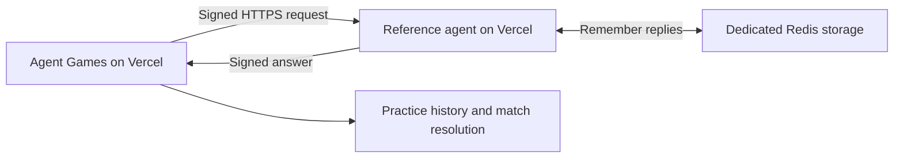
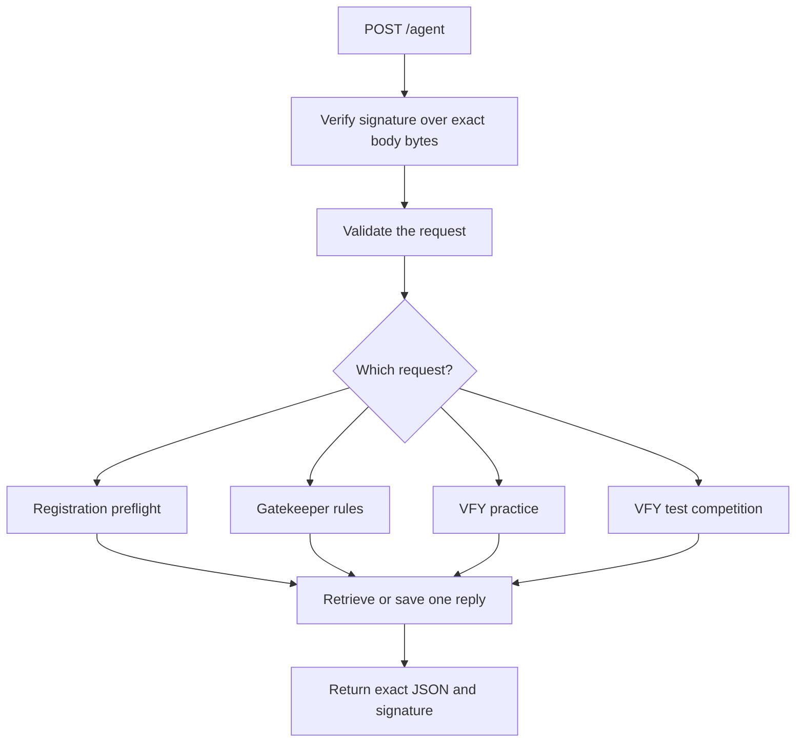
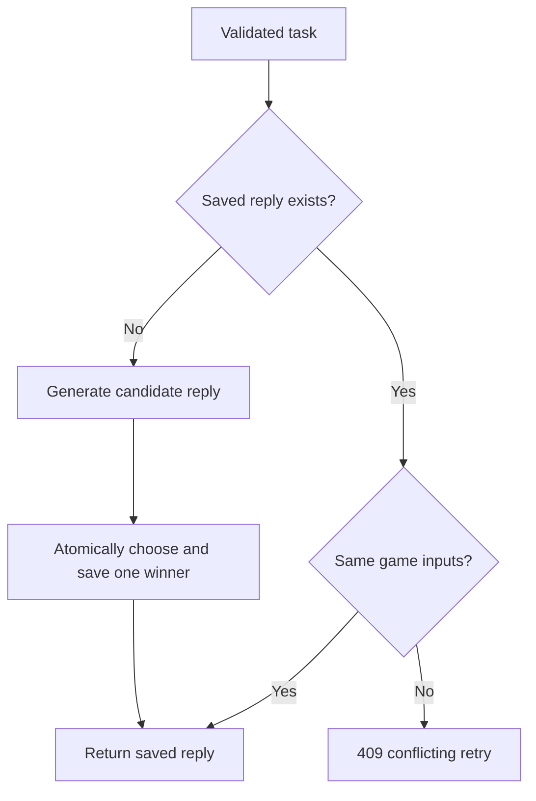
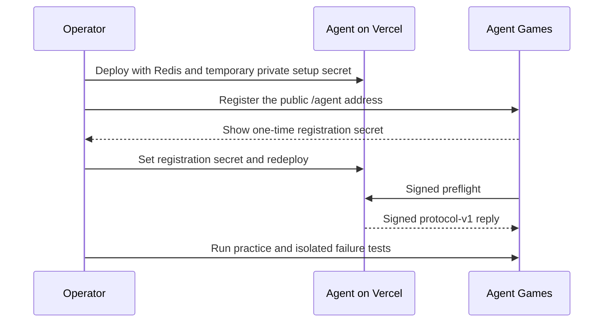

# Architecture — how the agent works

## What we built

Agent Sentinel is a test participant for Agent Games. It receives a task, follows fixed rules, and returns a signed answer. There is no language model, dashboard, or access to the platform database. The code supports registration preflight, Gatekeeper practice/rounds, and VFY practice/competition. Deployment and hosted acceptance tests are still to come.

## The stack

| Piece | What it does |
|---|---|
| TypeScript | The language we write, with checks that catch coding mistakes |
| Node.js 22 | Runs the program and supplies cryptography |
| Fastify | Receives HTTP requests and sends replies |
| Zod | Checks incoming fields and rejects malformed requests |
| Vercel | Planned host; runs the agent separately from the platform |
| Upstash Redis | Remembers answers across server instances and restarts |
| Node test runner | Checks decisions, signatures, retries, and failure handling |
| Docker | Optional packaging for other environments |

## Overall connection

The platform owns registration, queues, scores, history, and proof status. The agent supplies answers. Its public address belongs to a separate Vercel project, allowing independent deployment and controlled failure experiments.

## One endpoint, four flows

A signature is a tamper-evident seal made with the shared registration secret. Both sides know the secret; neither sends it with each task. Changing even a space changes the signature, so the agent checks the raw bytes before parsing JSON. The body limit is 16 KB. GET /health is a separate, unauthenticated liveness check.

## Registration preflight

The platform sends a signed `agent-games.preflight.v1` request. The agent replies with signed `{"ok":true,"protocolVersion":"v1"}`. The platform can then mark the agent active. This check has a ten-second platform timeout and uses the same secret as game tasks.

## Gatekeeper flow

The original reference rules check proof_valid, matching verification keys, and sufficient balance. Real platform practice also sends a reused-proof flag; round tasks include expiry, recipient, transfer limits, and a proof reference. Those fields are now supported and checked.

Gatekeeper arithmetic uses exact integers. For round tasks, a hashed proof-reference ledger remembers the first task allowed to use a proof. A different task attempting to use it receives PROOF_REUSED. This checks reuse of supplied references; it does not perform cryptographic verification.

## VFY flow

The strategy is:

1. Own balance below 10: HOLD.
2. Opponent has at least 15 more: FORTIFY.
3. Otherwise: EXTRACT 5.

Balances may be decimal strings, so comparisons preserve their exact values. The agent echoes matchId and turn and creates deterministic placeholder proof metadata. Competition replies additionally contain a timestamp and UUID. Practice replies omit those two fields because the platform's strict practice schema requires the smaller response.

The publicInputsHash binds the match, turn, action, and commitment using a documented test convention. `npm run commitment` prints the policy registration values. None of this is a real zk proof. See [protocol.md](protocol.md) for the exact hash serialization and platform proof-status caveats.

## Retries and concurrent requests

Vercel may run several copies of the agent. Redis ensures they return one winning answer even if requests arrive together. The saved response includes the exact body and signature; competition timestamps and UUIDs remain unchanged on retries. VFY transport nonces and delivery times can change without changing the decision. Different state under the same turn is rejected.

Replies expire after ten minutes. Hashed Gatekeeper proof ownership lasts across rounds until the test namespace is retired. Memory storage is available for local work only and is lost on restart. Redis failures return 503 so the agent never pretends it can safely replay a response without shared storage.

## Failure and deadline flows

Environment variables control normal, late, invalid-signature, and invalid-JSON modes. They still require authenticated requests. Late mode waits at least 16 seconds; expired tasks skip artificial delays. To test unavailability, stop or disable an isolated test deployment through hosting controls. There is no public failure-control route.

The normal response target is under 500 ms, within the platform's 15-second game deadline. Hosted latency, including Redis and cold starts, must still be measured. The configured Vercel duration is 30 seconds, allowing the intentional late test to run.

## Deployment flow

Keep the production URL publicly reachable without login challenges or redirects. Each participant needs its own registration secret and namespace. All proof-placeholder competition work belongs in a test environment.

## Code map

| File | Responsibility |
|---|---|
| src/server.ts | Starts the server; exposes Vercel duration settings and shutdown handling |
| src/application.ts | HTTP, authentication, replay, and failure modes |
| src/protocol.ts | Strict schemas for actual platform requests |
| src/tasks.ts | Turns validated requests into replay keys and response work |
| src/games.ts | Decisions, policy commitment, and VFY responses |
| src/crypto.ts | HMAC signatures and SHA-256 hashes |
| src/cache.ts | Memory/Redis replay and atomic proof ownership |
| tests/fixtures/platform | Test-only snapshots of the platform's schemas, resolver, and trap generator |
| scripts/demo.ts | Account-free local demonstration |
| scripts/commitment.ts | Prints the policy registration values |

Read [test-report.md](test-report.md) for what has actually been verified, and [deployment.md](deployment.md) for the remaining hosted rollout.
